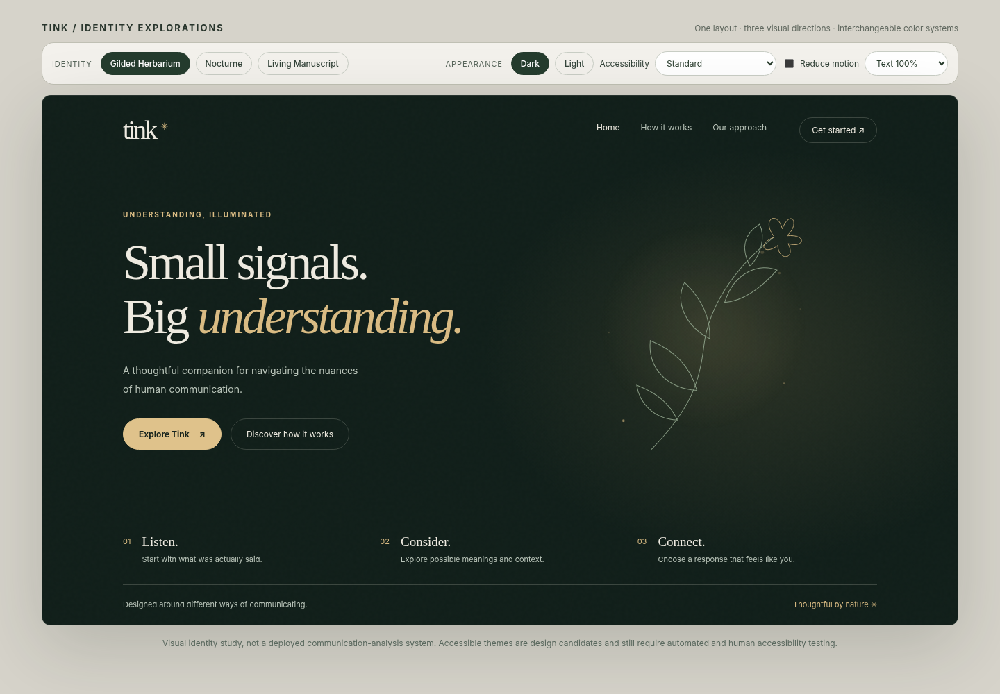
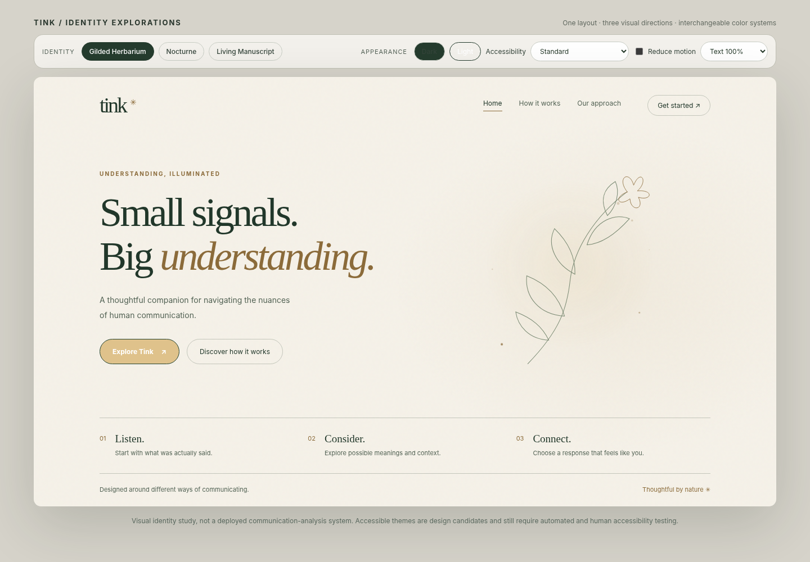
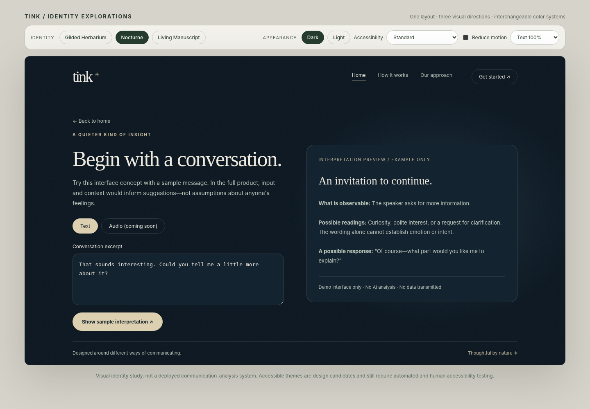

# tink. — Design identity & implementation handoff

**Status:** HackTX design direction and working *visual prototype*, October 23, 2026  
**Working line:** *Small signals. Big understanding.*  
**Audience:** design, frontend, interaction, accessibility, and demo teams

> **North star:** Quiet magic. A premium, serene communication-assistance experience: carefully crafted like a luxury chocolate bar, not decorated like a fantasy game.

## 1. Executive decision

Keep the name **tink.** and the established landing-page/application layout. Make the **Gilded Herbarium** the primary identity, with **Nocturne's** exceptionally restrained luminous effects and **Living Manuscript's** paper-like composure. Light/dark appearances are siblings, not separate websites. Accessibility preferences alter rendering without altering the core structure or task sequence. There are **no characters, fairies, silhouettes, wings as characters, or Tinker Bell depictions** in the final UI.

Tink's story connection is conceptual: small signals, delicate mechanisms, craftsmanship, illumination, and making subtle meaning visible. It should not resemble official Peter Pan/Disney branding, use a recognizable character silhouette, or depend on someone knowing the source material.

**What must not happen:** no forest photographs beneath body copy; no vines framing every card; no glowing outlines around every control; no hundreds of particles; no visual overload; no status conveyed by color alone; no claim that the interface can reliably read people's hidden intentions.



## 2. The brand in one sentence

**Tink makes complicated communication feel more approachable through calm, thoughtfully qualified interpretation.** It is an assistive companion, not a mind-reading tool, clinical diagnostic device, or replacement for asking another person what they mean.

### Brand attributes

- **Precise:** clear language, traceable observations, confidence calibrated to evidence.
- **Tender:** reassuring without patronizing or infantilizing.
- **Crafted:** meticulous spacing, typography, interactions, and color transitions.
- **Quietly mystical:** little points of light and botanical linework, never spectacle.
- **Inclusive:** multiple input methods and accessible outputs; no diagnosis required to change settings.

Tone: short, warm, concrete, non-judgmental. Say “One possible reading…” rather than “They are definitely upset.” Avoid rigid emotion labels and diagnostic language. When uncertainty matters, show it visibly.

## 3. Three studies, one final identity

1. **Gilded Herbarium — primary.** Matte forest backgrounds, fine botanical engraving, ivory, sage and warm muted gold. The strongest link to premium confectionery or perfume packaging.
2. **Nocturne — selective inspiration.** One delicate light path or softly illuminated point. Useful for analysis transitions; do *not* inherit a whole starfield or neon-blue interface.
3. **Living Manuscript — structural inspiration.** Spacious page composition and paper-like warmth; particularly useful for light mode and long-form explanations.

The attached concept boards are **exploration artifacts, not production specifications**. Some contain busier treatments that have since been rejected. The **interactive HTML prototype and its screenshots** are the better reference for the restrained direction.



## 4. The recognizable signature

Create a single proprietary **illuminated filament** graphic: a fine line that can read as a plant stem, a thread of light, or a waveform. It is a metaphor for finding meaning in small signals.

- Brand use: one delicate filament in the hero artwork, terminating in one or two light points.
- Interaction use: its curve may respond *once* when a process successfully completes.
- Content use: convert it into a quiet waveform motif only when analysis is the active task.
- Reduced-motion use: identical, static silhouette with no lost information.
- Accessible use: purely decorative SVG should be hidden from screen readers; meaningful progress must have its own text.

Do **not** use a winged character, a fairy icon in the wordmark, or hundreds of twinkling points. A wordmark `tink.` in a high-quality serif (e.g., Fraunces or another appropriately licensed face) plus a small abstract spark/stem is enough. Prefer a legible UI sans-serif (e.g., Inter) for all dense text and controls. Do not use script fonts for functional interface copy.

## 5. Visual rules and hierarchy

**Composition:** editorial first. Large text, short sentences, strong horizontal alignment, intentional empty space. Premium equals restraint and exactness, not darkness by itself.

**Visual budget** (directional, not a measurement): around 90% calm background, typography, and functional surfaces; about 10% botanical/light detailing. **One** hero focal ornament per screen, never multiple competing focal points.

**Decoration rules:**

- Only one botanical composition on a view, mostly on a page margin or far side of hero.
- At most approximately 3–6 static illumination points in the hero. Fewer in the app.
- In application views, illustrations should fade substantially or disappear; a single small motif can remain.
- Avoid gradients behind text, particle effects over interactive controls, strong drop shadows, and heavy glassmorphism.
- Use fine borders, matte surfaces, and subtle tonal elevation instead of floating stacks of cards.
- No imagery showing a fairy, personified pixie, silhouette, wings that read as an identifiable character, or Tinker Bell herself.

**Spacing/type targets:** 8px-based spacing scale; main desktop content width approximately 1120–1190px; generous hero padding; 16px body text default; body line-height 1.5–1.7; 12–16px typical card radii; comfortable touch targets. These are starting guidelines, not limits that should break responsive design.

**Responsive:** one layout and one content hierarchy across themes. On smaller screens the hero becomes stacked; ornamental art can shrink or be hidden. The primary CTA and critical text must remain usable on narrow viewports.

## 6. Color and theme architecture

Appearance is distinct from accessibility. A user's choices must compose cleanly:

```
Theme configuration
├── appearance: system | light | dark
├── contrast: standard | high
├── color-vision palette: default | deuteranopia-friendly | protanopia-friendly | tritanopia-friendly
├── sensory: standard | low-stimulation
├── motion: system | reduced
├── typography: default | large | extra-large
└── comprehension: standard | simplified
```

The current prototype groups some accessibility combinations into one dropdown. That is useful for comparison but **the production implementation should expose independent settings**, with sensible conflict precedence (high contrast should override purely decorative accent choices). Presets for color-vision differences are *candidates* requiring testing with color-vision simulations and real people. Do not assert they are universally “safe.”

### Starter design tokens

| Token | Dark | Light |
|---|---|---|
| `surface.base` | `#101E19` | `#F5F1E8` |
| `surface.raised` | `#1B2B23` | `#EBE9DF` |
| `text.primary` | `#EEEAE0` | `#21372A` |
| `text.secondary` | `#B9C4B9` | `#526254` |
| `accent.decorative` | `#D9BB83` | `#8B6B3A` |
| `action.fill` | `#DFC28B` | `#244330` |
| `action.text` | `#18241D` | `#FFFFFF` |
| `botanical.line` | `#93A78E` | `#6C7E66` |

These values reflect the **visual prototype**, not an approved contrast audit. Verify actual color combinations programmatically; ensure color is never the sole status channel. Use tokens, not hex colors hardcoded into components.

**High contrast:** near-black/white base pairs; strong focus indicators; no background glow or textures; preserve meaning and layout. **Low stimulation:** restrained palette, static visuals, no decorative particle animation, but maintain readable text contrast. **Color-vision modes:** use accessible contrast plus shapes/text/icons for every semantic state. Status may be `Observed`, `Possible`, `Uncertain` with labels and distinct symbols; never green/orange/purple alone.

### Example CSS organization

```css
:root { --surface: #f5f1e8; --text: #21372a; --action: #244330; --action-text: #fff; }
[data-appearance="dark"] { --surface: #101e19; --text: #eeeae0; --action: #dfc28b; --action-text: #18241d; }
[data-contrast="high"][data-appearance="dark"] { --surface: #000; --text: #fff; --action: #ffe36d; --action-text: #000; }
.button-primary { background: var(--action); color: var(--action-text); }
@media (prefers-reduced-motion: reduce) { *, *::before, *::after { scroll-behavior: auto !important; animation-duration: 0.01ms !important; } }
```

Persist explicit user preferences locally with consent-aware application storage; “system” should follow OS preferences. Avoid a flash of the wrong theme on first render. Make resets easy. No theme may reorder primary buttons, remove critical content, or change the route through the app.

## 7. Page-specific direction

### A. Marketing hero

Keep the existing split layout: wordmark/navigation, “Small signals. Big understanding.”, a two-line description, primary/secondary CTA, and **one** exquisite botanical filament illustration opposite the text. Below the fold: **Listen / Consider / Connect** as a sparse three-step row separated by hairlines—not large icon cards.

**No:** character renders, jungle backgrounds, dense flower borders, feature-card walls, particle overlays.

### B. Input/analysis

One clear focal task: *Start with a conversation.* Let people enter text with no microphone or camera required. Later allow audio, video and live modes as optional, permissioned extensions. No automatic recording; clearly mark microphone/camera state and provide pause/stop.

Sample mode must be obviously labeled as a demonstration. The provided HTML only implements a **text example** and a predetermined interpretation, **not an AI model**. It intentionally does not record, upload, or analyze actual audio/video.

### C. Results

Use hierarchy: **what is observed → possible interpretations → uncertainty / alternatives → useful response suggestion**. Separate evidence from speculation. Example: “The speaker asked for more information” (observed); “They may be curious or requesting clarification” (possible); “Text alone does not confirm emotion” (limitation); “You could ask what they’d like to know” (action).

Avoid “72% positive” unless a defensible model is actually calibrated, evaluated, and adequately explained. Prefer evidence-backed uncertainty to ornamental percentages. The results need text-first presentation that can be read aloud by assistive technology.

### D. Preferences/accessibility

Place accessible theme controls in a persistent settings area, and a small appearance shortcut in the header. Organize into Appearance, Reading/Comprehension, Motion/Sensory, Input/Media, Language, and Privacy. Every option should be available without disclosing a disability.



## 8. Accessibility acceptance criteria

Target **WCAG 2.2 AA** as a development goal, *not* as an achieved certification. Verify at least:

- 4.5:1 contrast for normal text and 3:1 for applicable large text and meaningful non-text elements.
- Keyboard-only use for all functionality; visible 3:1 focus indication against adjacent colors where applicable; no focus traps.
- Semantic HTML, correctly named controls, meaningful headings and landmarks, logical focus order; screen-reader testing (NVDA/VoiceOver).
- At least WCAG 2.2 AA minimum target sizing (24×24 CSS pixels or applicable exceptions); aim for larger primary actions.
- Reflow at narrow equivalent widths and up to 400% zoom; readable text at 200% resize without clipped controls.
- Respect reduced-motion settings; avoid flashing; no autoplay decorative motion; no essential information encoded in animation.
- Captions/transcripts for any actual audio/video functions, with permission controls and clear recording indicator.
- Color-independent semantic states, discernible controls and error recovery; descriptive, understandable labels.
- Low-stimulation and simplified presentation that do not omit required information.
- Testing with assistive technologies and users with diverse needs, not only automated audit tools.

Recommended QA matrix: desktop light/dark, mobile light/dark, high contrast in each, each color-vision preset in each, low-stimulation, 200% text, 400% zoom, keyboard-only, NVDA or VoiceOver, and browser/system reduced-motion. Check all key screens, not just the landing page.

## 9. Interaction language and motion

**Motion rule:** a visual cue must serve a purpose. 120–240ms hover/focus shifts are appropriate when they are nonessential; some users should see no movement. Add only a few fixed firefly-like lights in the hero and optionally one quiet light sweep on completed actions. Avoid looping sparkles in the analysis workspace.

**Iconography:** thin, consistent line icons. Neutral abstract spark or stem for brand; practical UI icons only when accompanied by labels in major navigation. Do not turn the cursor into a fairy or give the user an animated companion to manage.

**Microcopy samples:**

- “Begin with a conversation.”
- “Here’s what can be observed.”
- “A few possible interpretations.”
- “What we can’t tell from this alone.”
- “One response you could try.”
- “No recording begins until you choose Start.”

## 10. Build order for HackTX

**Priority 0 — reliable demo story.** Pick a defensible text-based scenario that works reliably in front of judges. Show the user selecting a preferred theme and receiving a cautious interpretation of observed text. Make the product purpose clear immediately.

**Priority 1 — foundations.** Component styles, semantic tokens, light/dark, responsive landing/input/results shell, well-labeled text input, keyboard navigation, consent boundaries.

**Priority 2 — inclusion.** High-contrast themes, reduced motion, text scale, caption/transcript path if media exists, color-independent semantic states, preferences persistence, screen-reader QA.

**Priority 3 — core inference (if implemented).** Input processing, evidence vs interpretation separation, alternatives, uncertainty, optional feedback. Consider fairness, generalization across expression styles/languages, privacy and consent; do not promise emotion-reading accuracy without testing.

**Priority 4 — one signature flourish.** Refine the illuminated filament as an SVG, then add just one subtle transition. Refuse ornamental scope creep until the product is functional and accessible.

**Priority 5 — judge rehearsal.** Show the same layout in dark, light, high contrast, and low-stimulation. Demonstrate text-only operation and control without color or animation. Explain user needs carefully without claiming to represent populations that were not studied.

### Demo narrative (about 90 seconds)

1. “We built Tink to help people explore the ambiguity of communication, not guess hidden emotions.”
2. Switch dark to light: same layout, no retraining or separate site.
3. Switch high contrast or reduced motion, then navigate using the keyboard.
4. Enter a safe sample sentence and show observation, alternatives, uncertainty and a suggested clarification.
5. End: “Communication is nuanced. The UI should be accessible even before the model makes a suggestion.”

## 11. Prototype inventory and exact limitations

**Open:** `prototype/index.html` in a modern browser. It is a single-file standalone concept; no build system or network connection is required.

The prototype includes three identity buttons (Gilded Herbarium / Nocturne / Living Manuscript), dark/light, contrast/color-vision/low-stimulation **visual presets**, a reduce-motion control, 100%/112%/125% text scaling, a responsive layout, and a demo text interpretation. The visual presets are *not verified accessible palettes*; zoom, keyboard and screen-reader tests are still needed. No backend, microphone capture, camera capture, AI inference, deployed authentication, multilingual inference, or saved user profile is implemented.

### Files

- `prototype/index.html` — source; open locally.
- `prototype/preview-dark.png` — recommended primary visual benchmark.
- `prototype/preview-light.png` — same structure in light mode.
- `prototype/preview-nocturne.png` — lighting-direction comparison.
- `prototype/preview-analysis.png` — actual text-demo interaction screen.
- `prototype/preview-mobile.png` — responsive sample.
- `reference-concepts/01-minimal-luxury-exploration.png` — later moodboard; not production specification.
- `reference-concepts/02-theme-architecture-exploration.png` — later high-level theme explorations; ornamental density is not a target.
- `reference-concepts/03-interface-exploration.png` — later UI concept visual; use as inspiration, not the current feature inventory.

## 12. Design review checklist — pass/fail

- Can someone identify the primary task in three seconds?
- Does the page retain its hierarchy when all artwork, motion and color accents are removed?
- Are there fewer than two competing visual focal points?
- Is every magic detail intentional, not a repeated sticker?
- Is the content fully legible with font scaling and narrow reflow?
- Do semantic states remain understandable in grayscale and to screen readers?
- Does theme switching preserve exactly the same workflow?
- Are there zero recognizable fairy/Disney/Peter Pan character depictions?
- Do examples distinguish observable signals from interpretations and limitations?
- Is the demo truthful about which features actually work?

**Final creative recommendation:** Build the Gilded Herbarium system; adopt a single illuminated filament from Nocturne, and the generous editorial spacing of Living Manuscript. *Less fantasy illustration, more visual craftsmanship.*
